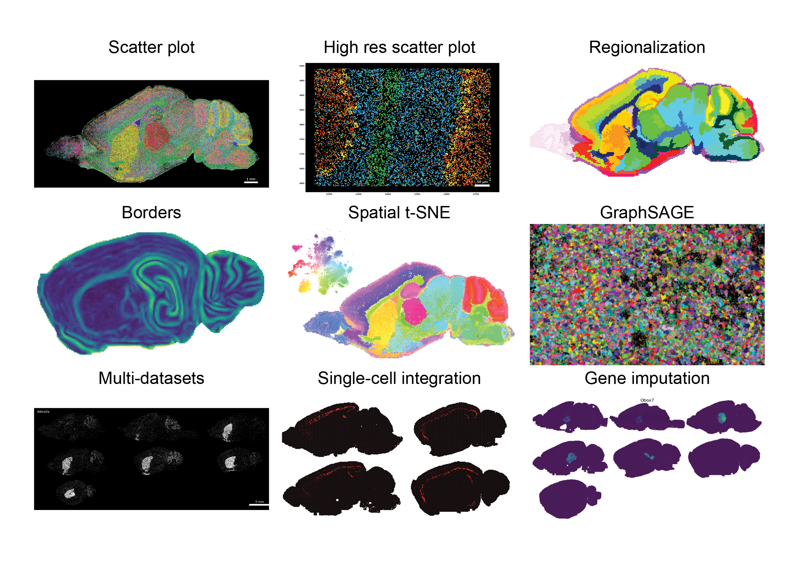

# FISHscale

> *Everything that glitters ain't fishscale*
> 
> <cite>*-- MF Doom - Figaro, Album: Madvillain*</cite>

Software package for the visualization, exploration and analysis of point based spatial transcriptomics data. FISHscale can load single or multiple datasets.  

FISHscale is made for the future with ever increasing dataset size, and where multiple datasets need to be jointly analyzed. FISHscale uses Dask to store all data on disk and only loads what it needs to make analysis memory efficient.

# Applied to adult mouse EEL spatial transcriptomics data

Paper: [BioRxiv](https://www.biorxiv.org/content/10.1101/2022.01.12.476082v1)

Images are available here: [EEL-FISH data](https://figshare.com/projects/Scalable_in_situ_single-cell_profiling_by_electrophoretic_capture_of_mRNA_using_EEL_FISH/143616)

The raw image data is large, around 20 TB for all datasets. If you want to have access to any or all datasets please contact us. The best way is probably by shipping a hard drive.

If you require any other raw data or have questions about the files, feel free to contact us.

# Gallery
### Visualization


### Analysis
  

# Getting started

The following instructions should work for Linux and Mac, and probably also Windows.

Make a fresh Anaconda environment: (Open3D does not work with python 3.10)
```
conda create --name my_env python=3.7 
conda activate my_env
```

Then install FISHscale:
```
git clone https://github.com/linnarsson-lab/FISHscale.git
cd FISHscale
pip install -e .
```
You can download all data realated to the EEL FISH paper from [FigShare](https://figshare.com/projects/Scalable_in_situ_single-cell_profiling_by_electrophoretic_capture_of_mRNA_using_EEL_FISH/143616) and use it as example data.  

Use the [single-dataset](https://github.com/linnarsson-lab/FISHscale/blob/master/example_notebooks/FISHscale_tutorial_single_dataset.ipynb) notebook to get started with single datasets.
  
If you want to use multiple datasets, use the [multi-dataset](https://github.com/linnarsson-lab/FISHscale/blob/master/example_notebooks/FISHscale_tutorial_multi_dataset.ipynb) notebook to get started with multi-dataset objects. 

### Linux and Open3D
If the visualizer does not open the window after calling `.visualize()`, please follow these steps:  
- Uninstall Open3D: `pip uninstall open3d`
- Build Open3D from source using these instructions: [Open3D](http://www.open3d.org/docs/release/compilation.html)
